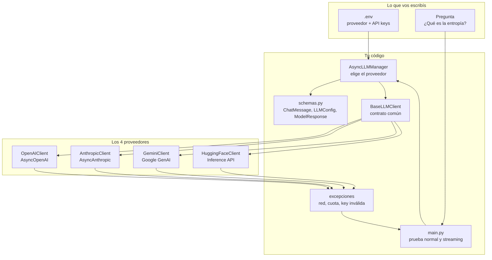
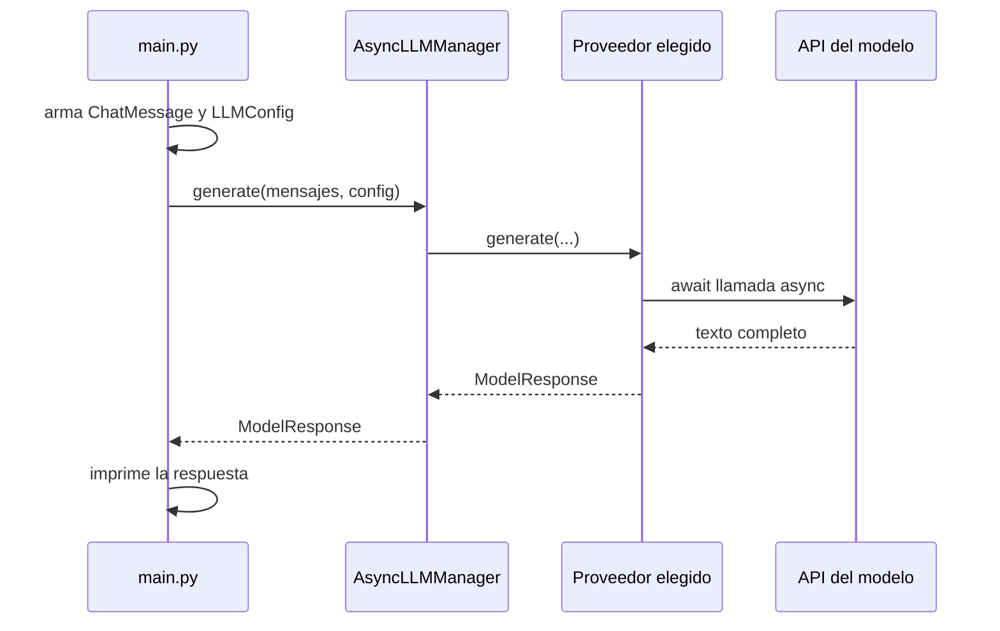
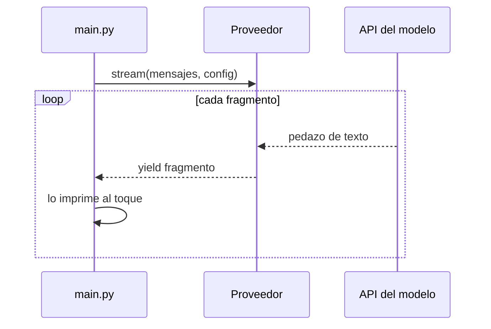

# Arquitectura — cliente async unificado de LLMs

Este archivo explica cómo está partido el sistema y por qué. No se ejecuta. Sirve para mirar el mapa antes de leer el código: qué pieza llama a cuál, qué hace una llamada normal, qué hace el streaming y en qué orden se construye.

El código entra en los pasos siguientes. Acá solo está el mapa.

## La idea en una frase

Un solo programa hace una pregunta. Una clase (`AsyncLLMManager`) decide si responde OpenAI, Claude, Gemini o Hugging Face. Los cuatro hablan el mismo idioma: mensajes validados, respuesta estructurada, y streaming token por token.

## Diagrama del sistema



## Qué pasa cuando preguntás (modo normal)



`await` significa: “esperá esta respuesta de internet **sin frenar** el programa”. El cliente oficial tiene que ser el asíncrono (`AsyncOpenAI`, `AsyncAnthropic`, etc.). Si se usa el cliente síncrono dentro de una función `async`, el programa queda congelado mientras el modelo piensa. Eso es el error de “bloquear el event loop”.

## Qué pasa en streaming



En vez de esperar el párrafo entero, la API manda trozos. El método de streaming es un **generador asíncrono**: adentro hay un `async for` que recorre el stream del SDK y un `yield` que entrega cada trozo.

## Las piezas y para qué sirve cada una

| Pieza | Archivo | Rol |
| --- | --- | --- |
| Mensajes y config | `unidad_1/pre_entrega/llm_client/schemas.py` | Pydantic valida antes de llamar a la API. Un rol inválido o una temperatura fuera de 0–2 falla acá, con un error claro. |
| Contrato | `unidad_1/pre_entrega/llm_client/base.py` | `BaseLLMClient` dice: todo proveedor tiene `generate()` y `generate_stream()`. |
| Errores | `unidad_1/pre_entrega/llm_client/exceptions.py` | Una key mala, un corte de red o un rate limit se convierten en un error controlado. El `main` no se cae. |
| Fábrica | `unidad_1/pre_entrega/llm_client/manager.py` | `AsyncLLMManager` lee `LLM_PROVIDER` y devuelve el cliente correcto. |
| Proveedores | `unidad_1/pre_entrega/llm_client/providers/` | Cada empresa traduce nuestro formato al suyo y la respuesta de vuelta al nuestro. |
| Prueba | `unidad_1/pre_entrega/main.py` | Carga el `.env` y pregunta “¿Qué es la entropía?” en modo normal y en streaming. |

## Por qué Pydantic va primero

Sin un esquema, cada proveedor termina armando diccionarios distintos (`{"role": ...}` en uno, `{"type": "text"}` en otro) y el error aparece recién cuando la API rechaza el pedido. Con Pydantic el formato es uno solo:

- `ChatMessage`: `role` (`system`, `user`, `assistant`) y `content` (texto).
- `LLMConfig`: proveedor, nombre del modelo, `temperature` entre 0 y 2, `max_tokens` mayor que 0, y las API keys.
- `ModelResponse`: texto, proveedor, modelo, y si salió bien o con error controlado.

Cada cliente traduce esa estructura al formato de su SDK. `main.py` nunca arma el JSON de OpenAI ni el de Anthropic a mano.

## Los 4 proveedores

El enunciado pide **OpenAI** y **Anthropic** sí o sí, con los SDK oficiales asíncronos. Sumamos dos más, con la misma interfaz, para poder cambiar de modelo tocando una variable.

| Proveedor | Qué es | SDK que vamos a usar | Variable de entorno |
| --- | --- | --- | --- |
| OpenAI | GPT (de pago, con crédito) | `openai.AsyncOpenAI` | `OPENAI_API_KEY` |
| Anthropic | Claude (de pago, con crédito) | `anthropic.AsyncAnthropic` | `ANTHROPIC_API_KEY` |
| Gemini | Google, con cupo gratis en AI Studio | `google-genai` (cliente async) | `GEMINI_API_KEY` |
| Hugging Face | Plataforma con varios modelos y un cupo gratis limitado | `huggingface_hub.AsyncInferenceClient` | `HF_TOKEN` |

Hugging Face **no es un modelo**. Es un catálogo. La cuenta gratis te deja usar la Inference API con un tope (crédito y rate limit chicos). Elegís un modelo concreto, por ejemplo un instruct chico que el router acepte. No es “IA ilimitada”.

Para probar sin gastar, el camino más cómodo suele ser **Gemini** (AI Studio) o **Hugging Face**. OpenAI y Claude quedan listos para cuando tengas crédito.

## Errores que no deben tirar abajo el programa

| Situación | Qué hace el cliente |
| --- | --- |
| Key inválida o ausente | Devuelve `ModelResponse` con error `auth`. No hay reintento: la key no se arregla sola. |
| Rate limit (429) o corte de red | Reintenta unas pocas veces con una pausa corta. Si sigue fallando, devuelve error `rate_limit` o `network`. |
| Cualquier otro fallo del proveedor | Devuelve error `provider` con el mensaje, y el `main` lo imprime. |

## Carpetas

```text
unidad_1/pre_entrega/
├── main.py                      ← prueba normal + streaming
├── requirements.txt
└── llm_client/
    ├── __init__.py
    ├── schemas.py
    ├── exceptions.py
    ├── base.py
    ├── manager.py
    └── providers/
        ├── __init__.py
        ├── openai_client.py
        ├── anthropic_client.py
        ├── gemini_client.py
        └── huggingface_client.py
```

## Orden de construcción

1. **Mapa y carpetas** — este documento. Hecho.
2. **Esquemas Pydantic** — `ChatMessage`, `ModelConfig`, `ModelResponse`.
3. **Contrato y errores** — `BaseLLMClient` y excepciones controladas.
4. **OpenAI y Anthropic** — lo que el enunciado exige.
5. **Gemini y Hugging Face** — los dos extra.
6. **Manager** — elegir proveedor con `LLM_PROVIDER`.
7. **main.py, entorno y README de ejecución** — la pregunta de entropía en ambos modos. El archivo quedó en `unidad_1/pre_entrega/main.py`.
