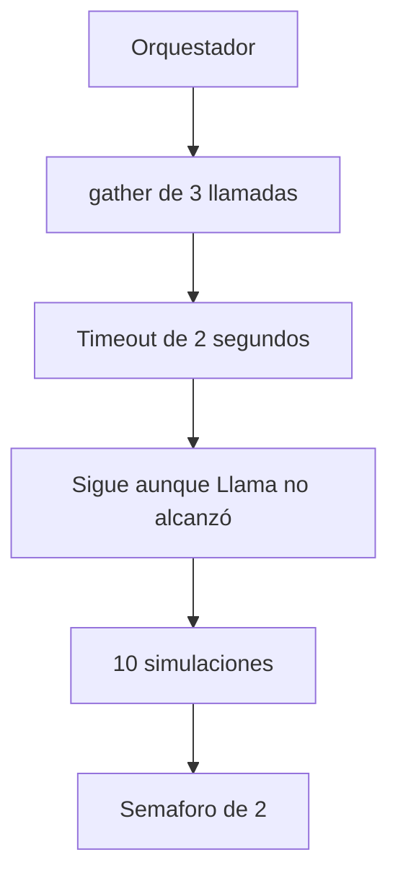

# Ejercicio opcional 1

Simula varias llamadas a modelos al mismo tiempo. No usa ninguna API: las esperas son `asyncio.sleep`.

## Qué recordar

- `asyncio.gather` dispara las tres llamadas juntas. El tiempo total es el de la más lenta, no la suma.
- `asyncio.timeout(2)` corta el grupo entero. Llama tarda 3 segundos, así que esa parte termina en `TimeoutError` y el programa sigue.
- El `Semaphore(2)` deja 2 de 10 simulaciones adentro a la vez. El resto espera un lugar.

```bash
python unidad_1/ejercicio_opcional/orquestador.py
```


