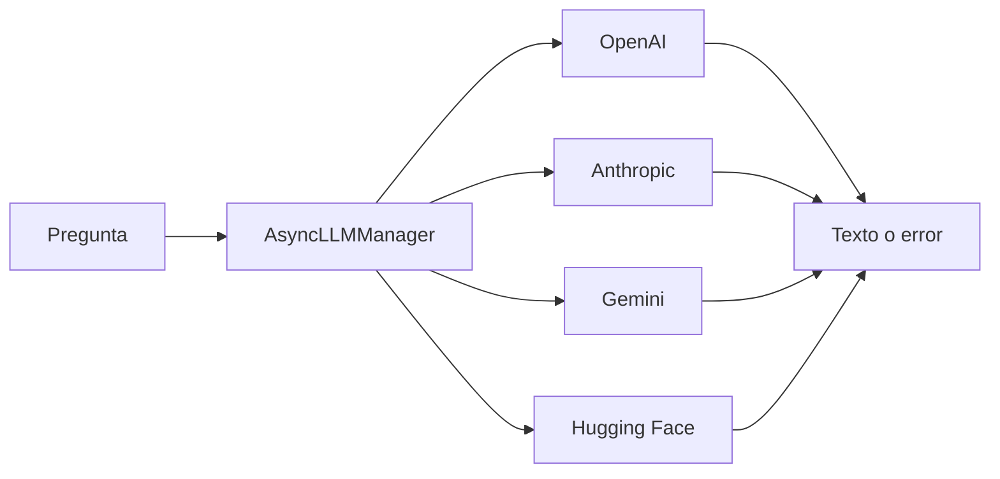

# Pre-entrega 1

Un cliente async que habla con OpenAI, Anthropic, Gemini y Hugging Face usando la misma interfaz. La pregunta de prueba es «¿Qué es la entropía?».

## Qué recordar

- Cada proveedor es una clase distinta detrás de la misma interfaz. El resto del programa no sabe cuál está respondiendo.
- `generate` espera la respuesta completa. `generate_stream` va soltando pedazos.
- Si falta la key o es inválida, el error queda en `resultado.error`. El programa sigue con el siguiente proveedor.
- OpenAI y Anthropic se saltan porque esas keys están vacías. Gemini es el que responde. Hugging Face está armado, y hoy la cuenta no tiene crédito.
- Las keys viven en el `.env` de la raíz y no se suben.

```bash
python -m unidad_1.pre_entrega.main
```


