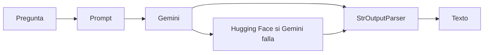

# Ejercicio opcional 2

Una cadena LCEL asíncrona. Pregunta qué es LangChain y deja la respuesta en texto plano.

## Qué recordar

- LCEL es el operador `|`. El orden es `prompt | modelo | parser`.
- El prompt arma el mensaje. El modelo responde. `StrOutputParser` se queda solo con el texto y tira el resto del sobre.
- `ainvoke` corre la cadena con `await`.
- El modelo es Gemini. Si Gemini falla, `with_fallbacks` prueba Hugging Face. Las dos piezas salen de `unidad_2/modelos.py`.

```bash
python -m unidad_2.ejercicio_opcional.refactorizacion_lcel_asincrono
```


