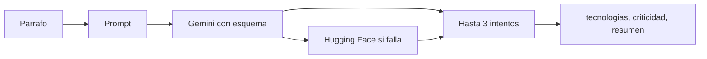

# Pre-entrega 2

De un párrafo técnico saca un objeto validado: tecnologías, criticidad y un resumen. No devuelve un texto libre.

## Qué recordar

- Pydantic es el contrato. `tecnologias` no puede venir vacía. `nivel_de_criticidad` solo acepta `baja`, `media` o `alta`.
- La cadena sigue siendo `prompt | modelo`. El modelo ya trae salida estructurada, un respaldo y tres reintentos.
- El respaldo se arma así: primero cada modelo con su salida estructurada, después `with_fallbacks`, después `with_retry`. Al revés, el respaldo no sabe devolver el objeto.
- Hugging Face no arma el objeto de Pydantic por function calling. Usa `json_schema`.
- El enunciado nombra OpenAI o Anthropic. Esas APIs se cobran. Corre Gemini. Cómo se armarían las otras dos quedó comentado en `unidad_2/modelos.py`.

El texto de prueba nombra FastAPI, Redis y PostgreSQL, y la criticidad sale alta. Cómo correrlo está en [README.md](README.md).

