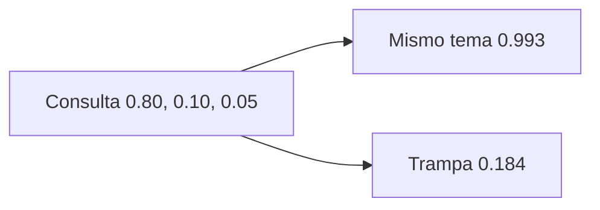

# Ejercicio opcional 3

Mide si dos vectores apuntan al mismo tema. El entregable de la plataforma es el PDF de esta carpeta. El script solo muestra la cuenta.

## Qué recordar

- La similitud coseno vale 1 cuando los vectores miran al mismo lado y cerca de 0 cuando miran a otro.
- En el ejemplo, la consulta contra la oración del mismo tema da **0.993**. Contra la trampa de palabras da **0.184**.
- Esos tres vectores son números de ejemplo. No son embeddings de oraciones reales.
- Un embedding acerca textos por tema. Una negación («esto no se despliega») puede quedar cerca del texto original, porque las palabras del tema siguen ahí.

```bash
python unidad_3/ejercicio_opcional/similitud.py
```


