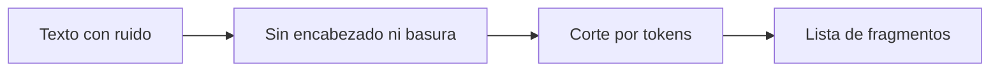
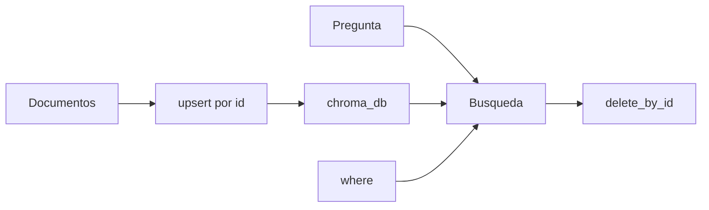

# Ejercicios sueltos de la unidad 3

Estos dos scripts quedaron en la carpeta de la unidad, fuera de `pre_entrega` y de `ejercicio_opcional`.

## DocumentProcessor

`document_processor.py` limpia un manual y lo corta en fragmentos medidos en tokens, no en caracteres.

- Saca el encabezado repetido de cada página, los cuadrados negros y los espacios de más. Los saltos de línea se quedan, porque el corte los usa.
- `chunk_size` 500 y `chunk_overlap` 50 son el defecto. La prueba usa 40 y 10 para ver el corte en un texto corto.
- `process_document` devuelve la lista. El `print` está en el `if __name__`, no dentro de la clase.

## VectorMemoryManager

`vector_memory.py` es una memoria de Chroma en disco: insertar, buscar, filtrar y borrar.

- `PersistentClient` guarda la base en `./chroma_db`. Al cerrar el programa, los documentos siguen.
- `upsert` actualiza si el id ya existe.
- `semantic_search` devuelve `document`, `metadata` y `distance`. `where` filtra, por ejemplo `source = tech_blog`.
- `delete_by_id` borra por id. Después de sacar `doc2`, `count()` da 2.
- Si el disco falla, el método lanza un `RuntimeError` y no sigue como si hubiera guardado.

