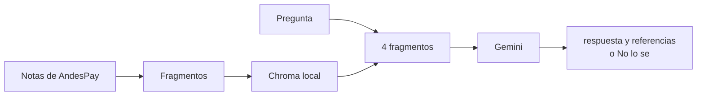

# Pre-entrega 3

Un RAG local. Las notas de AndesPay se cortan, se guardan en Chroma en esta máquina y Gemini responde solo con esos fragmentos.

## Qué recordar

- Mismo modelo de embeddings para indexar y para preguntar: `gemini-embedding-001`. Si fueran dos modelos, la distancia no significaría nada.
- El corte es de 500 tokens, con 50 de solape. Si la colección ya tiene fragmentos, no se vuelve a indexar.
- La cadena busca 4 fragmentos, se los pasa al prompt y Gemini devuelve `respuesta` y `referencias`.
- Si la pregunta no está en el contexto, `respuesta` es exactamente «No lo sé» y `referencias` queda vacía. La prueba que no está es el precio del plan enterprise. La que sí está es Redis caído.
- Chroma vive en `vectorstore/` y no se sube a GitHub. Se regenera al ingestar.

Cómo correrlo está en [README.md](README.md).

