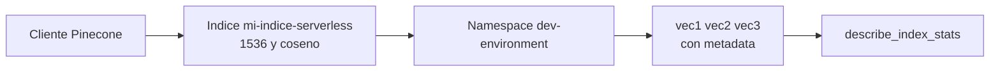

# 4.1 Pinecone Serverless

Crea un índice en la nube, guarda tres vectores de prueba en un namespace y lee las estadísticas. El índice `mi-indice-serverless` queda en tu cuenta de Pinecone. El de la pre-entrega, `coderhouse-unidad-4`, no se toca.

## Qué recordar

- El **índice** fija dos cosas que no se pueden mezclar: la dimensión (1536) y la métrica (coseno). Un vector de otro largo lo rechaza.
- El **namespace** `dev-environment` es una partición dentro del índice. Estos tres vectores no se mezclan con los de `biblioteca`.
- Cada vector es una tupla `(id, valores, metadata)`. La metadata de acá es `topic` y `priority`.
- `upsert` con el mismo id actualiza. No duplica.
- `describe_index_stats()` puede tardar unos segundos en contar. Por eso el script vuelve a preguntar si ve 0.

Salida que ya vimos: dimensión 1536, namespace `dev-environment` con 3 vectores, `total_vector_count` 3.

```bash
python unidad_4/4.1/pinecone_serverless.py
```


