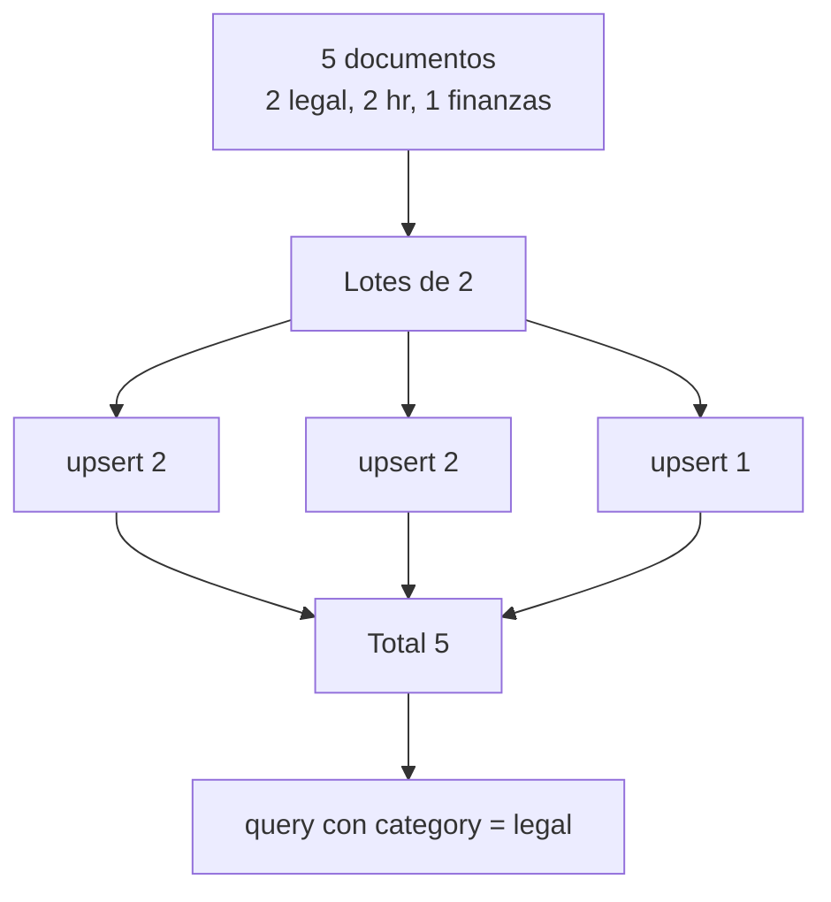

# 4.2 Ingesta por lotes y metadatos

No llama a Pinecone. Un índice simulado recibe documentos de a lotes y después acepta una búsqueda con filtro.

## Qué recordar

- Subir de a uno gasta un viaje de red por vector. Un **lote** junta varios en un solo `upsert`. Con 5 documentos y `batch_size=2` salen tres lotes: 2, 2 y 1. El total es 5.
- La metadata tiene siempre los mismos campos: `category`, `author`, `ingested_at` y `char_count`. Si un proceso usa otro nombre, el filtro no encuentra el documento.
- El filtro `{"category": {"$eq": "legal"}}` es un corte duro: la búsqueda solo mira esa categoría. El mock devuelve `matches` vacío. Lo que se evalúa es el filtro, no un resultado real.
- El vector `[0.1] * 8` es falso. Acá importa el lote y el filtro, no el embedding.

```bash
python unidad_4/4.2/ingesta_metadatos.py
```


