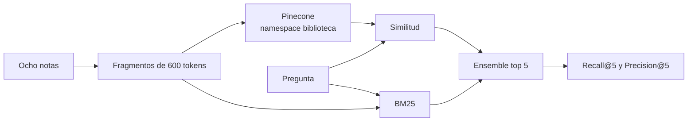

# Pre-entrega 4

Un RAG en Pinecone: las notas se suben a un índice Serverless, una pregunta se busca con vectores y con palabras, y un script mide si el documento correcto apareció.

## Qué recordar

- Los embeddings son de Gemini, recortados a **1536**, el mismo tamaño del índice. Indexar y buscar usan el mismo modelo.
- El texto del fragmento vive en la metadata (`texto`), junto con `documento_id`, `fuente`, `pagina`, `categoria` y `etiquetas`.
- El namespace `biblioteca` separa estas notas de los vectores de prueba del 4.1.
- El corte es de 600 tokens, con 80 de solape. Quedaron 16 fragmentos, dos por nota.
- `RAGSystem` mezcla Pinecone (sentido de la frase) y BM25 (palabras exactas como `Task` o `Depends`) y devuelve 5.
- **Recall@5** vale 1 si el documento esperado está entre los 5. **Precision@5** es qué fracción de esos 5 pertenece a ese documento. El techo acá es 0.40, porque cada nota tiene dos fragmentos. El resultado fue 1.00 y 0.40.

Cómo replicar el índice está en [README.md](README.md).

