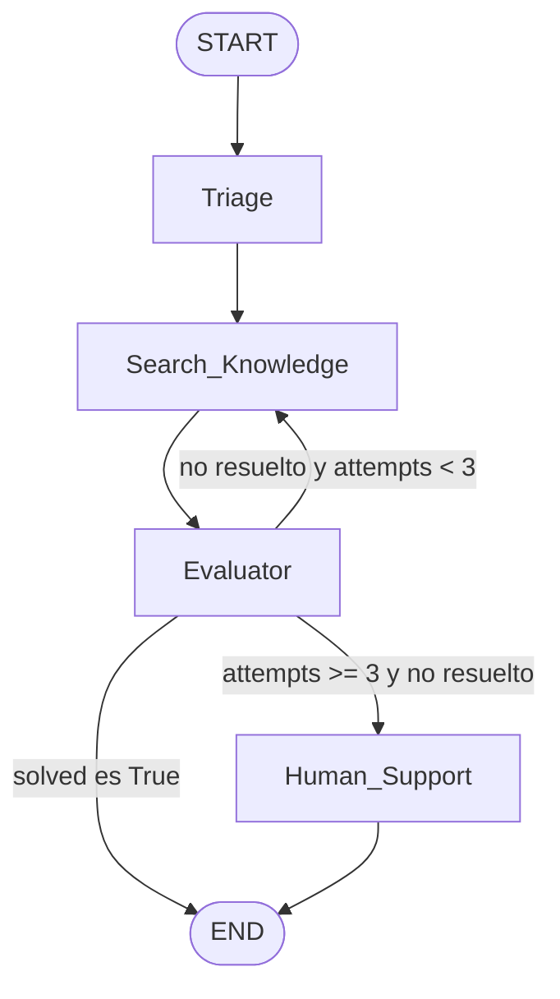

# 5.1 Asistente de soporte técnico multinivel

El sistema recibe una duda, la clasifica, busca una solución y decide si alcanza, si hay que buscar de nuevo o si el caso pasa a un humano. No es una cadena recta: hay un ciclo.

## Estado

```python
class SupportState(TypedDict):
    messages: Annotated[list[BaseMessage], add_messages]
    is_escalated: bool
    attempts: int
    solved: bool
```

`messages` usa el reducer `add_messages`: un nodo agrega mensajes, no borra los anteriores. `solved` no lo pedía el enunciado al pie de la letra y hace falta para que la arista sepa si la solución sirvió. `is_escalated` solo lo pone en `True` el nodo `Human_Support`.

## Arista condicional

Sale de `Evaluator`:

| Condición | Camino |
| --- | --- |
| `solved` es `True` | `END` |
| `attempts >= 3` y no está resuelto | `Human_Support` y después `END` |
| no está resuelto y `attempts < 3` | vuelve a `Search_Knowledge` |

Esa vuelta es el ciclo. El tope de 3 intentos evita que el ciclo no termine.

```bash
python unidad_5/5.1/grafo.py
```

El caso normal resuelve en el intento 2 y no escala. Si la duda dice «imposible», busca tres veces y `is_escalated` queda en `True`. El diagrama para subir está en [entregable.pdf](entregable.pdf).


