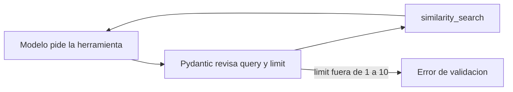

# 5.2 Tool calling

El modelo no corre Python. Pide una herramienta por nombre y argumentos. El programa valida esos argumentos, ejecuta la función y le devuelve el resultado.

## Qué recordar

- El contrato tiene nombre (`search_knowledge_base`), una descripción (el docstring) y un esquema de entrada (`SearchInput`).
- `query` es obligatorio. `limit` vale 3 si no viene, y solo acepta de 1 a 10. Con `50`, Pydantic corta antes de tocar la base.
- La función es `async`. Adentro, `similarity_search` va en un `try`. Si la base falla, vuelve un texto de error y el programa no se cae.
- La base de este ejercicio es simulada. Con la consulta «políticas de vacaciones» devuelve `['Resultado para políticas de vacaciones']`.

```bash
python unidad_5/5.2/herramienta.py
```


