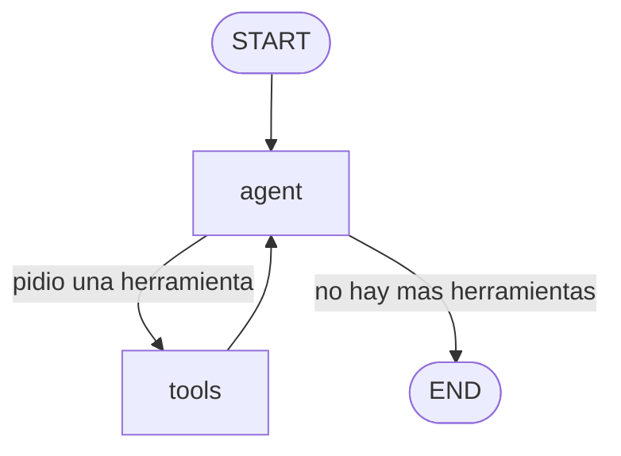

# 5.3 Ciclo ReAct y checkpoints

El agente piensa, llama a `get_weather` si hace falta, lee el resultado y recién ahí responde. `MemorySaver` guarda el estado después de cada nodo. Con el mismo `thread_id`, el segundo mensaje sigue la misma conversación.

## Qué recordar

- El estado es solo `messages`, con `add_messages`. Cada vuelta agrega mensajes. No los pisa.
- `tools_condition` mira si el modelo pidió una herramienta. Si pidió, va a `tools`. Si no, va a `END`. El grafo termina cuando el modelo deja de pedir herramientas.
- `tools` vuelve siempre a `agent`. Esa flecha es el ciclo ReAct: razón, acción, observación, y otra vez razón.
- El checkpointer es memoria del proceso, no un archivo. Con `dev_test_01` el primer turno deja 4 mensajes y el segundo llega a 8: la pregunta de Madrid sigue en el hilo, y la respuesta de Londres dice «también». Un `thread_id` nuevo arranca en 4 mensajes, sin Madrid.
- El enunciado nombra `ChatOpenAI`. Acá el modelo es Gemini, con `bind_tools`. El grafo es el mismo.

```bash
python unidad_5/5.3/agente.py
```


