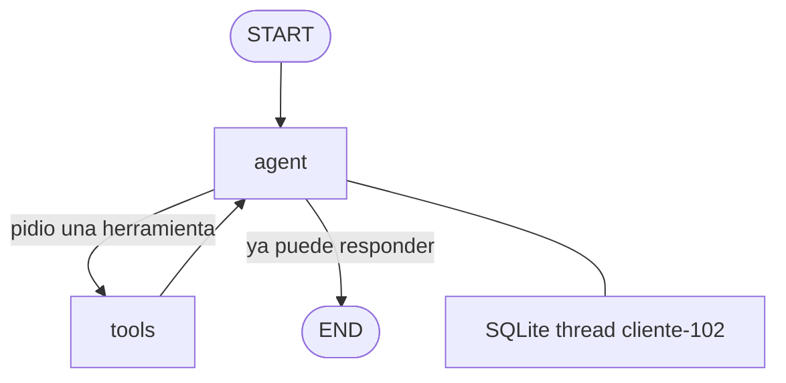

# Pre-entrega 5

El agente no tiene un `if` que elija la herramienta. Lee la pregunta, mira los docstrings y pide la que le falta. `AsyncSqliteSaver` guarda el hilo en un archivo SQLite. El mismo `thread_id` sigue la conversación. El enunciado nombra `SqliteSaver`: esa clase es síncrona y `ainvoke` exige la variante async.

## Qué recordar

- `EstadoAgente` hereda de `MessagesState`. El historial está en `messages` y se anexa con `add_messages`.
- `tools_condition` manda a `tools` si el modelo pidió una herramienta, y a `END` si ya puede responder. `tools` siempre vuelve a `agent`. Ese es el ciclo.
- Ninguna herramienta trae todo. `contar_pedidos` no tiene el dinero. `sumar_pedidos` no tiene la cantidad. Por eso la primera pregunta llama al menos dos veces. `ultimo_pedido` entra en la segunda pregunta.
- Si el cliente no existe, la herramienta devuelve un error en texto. El modelo puede pedir el id. El programa no se corta.
- `recursion_limit` es 10. Es el techo de pasos del ciclo.
- La base SQLite se borra al empezar el script. La traza de esa corrida queda en `traza.json`.

```bash
python unidad_5/pre_entrega/agente.py
```


