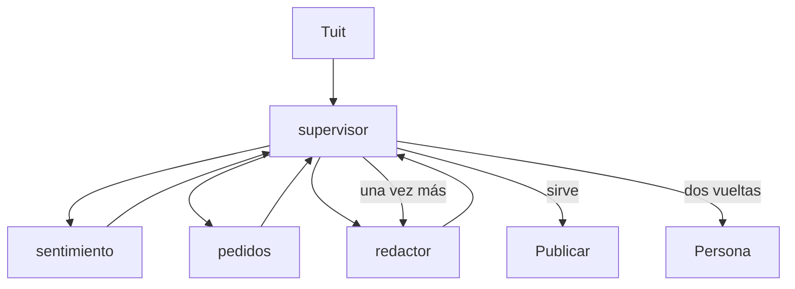

# 6.1 Quejas de Twitter: topología jerárquica

Una tienda recibe un tuit de queja. Hay que leer el ánimo, mirar el pedido y contestar en público. Un supervisor reparte. Tres especialistas hacen una sola cosa. Ninguno publica solo.

## Agentes

| Agente | Qué hace | Herramienta |
|---|---|---|
| Supervisor | Lee el tuit, pide el ánimo y el pedido, y solo él publica. Si falta un dato, manda a repetir una vez. | `publicar_respuesta` |
| Sentimiento | Dice si el tuit es enojo, neutro o calma, y de qué se queja (envío, producto, cobro). No mira pedidos. | `clasificar_sentimiento` |
| Pedidos | Busca el pedido por el usuario o el número que aparece en el tuit. Devuelve estado, fecha y si ya hubo un reembolso. No redacta. | `buscar_pedido` |
| Redactor | Escribe la respuesta con el ánimo y el estado del pedido. No inventa un reembolso ni una fecha. | ninguna: solo redacta |

## Flujo

1. Llega el tuit al supervisor. Ejemplo: «Llevo 9 días y el pedido 8841 no aparece».
2. El supervisor pide en paralelo dos cosas: el ánimo y el pedido. Los especialistas no se hablan.
3. Sentimiento devuelve: enojo, tema envío.
4. Pedidos devuelve: 8841, en tránsito, salió hace 6 días, sin reembolso.
5. El supervisor junta esos dos aportes y se los pasa al redactor. El redactor no ve el hilo entero, solo eso.
6. El redactor escribe una respuesta corta: reconoce la demora y dice el estado real.
7. El supervisor revisa: ¿cita el pedido? ¿no promete plata que la base no tiene? Si sirve, publica. Si no, pide una sola reescritura.
8. Tope: dos vueltas. Después se publica la última versión o se escala a una persona. No hay un crítico que corrija para siempre.

## Por qué jerarquía

La respuesta sale en público y a nombre de la tienda. Alguien tiene que ver el pedido antes de prometer algo. En una red de pares, el redactor podría contestar en cuanto ve el tuit, sin esperar la base, o el de sentimiento y el de pedidos podrían pisarse el texto. Acá el orden lo marca el supervisor: primero los datos, después la frase, y solo él publica.

Sentimiento y pedidos sí pueden trabajar a la vez. Eso no los vuelve pares: los dos le devuelven el resultado al mismo jefe.
