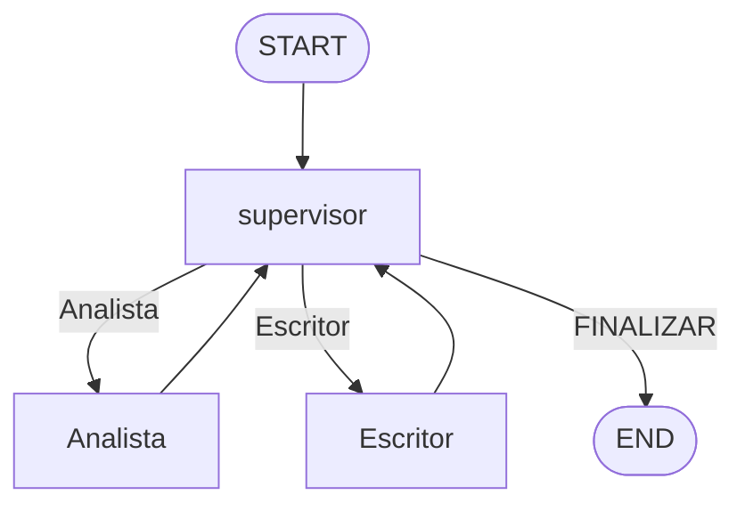

# 6.2 Supervisor

En cada paso el supervisor elige un nodo. No escribe el informe. El Analista deja el dato. El Escritor deja la frase. Recién ahí se cierra.

## Qué recordar

- `next` es la flecha. El supervisor la escribe. La arista condicional la lee.
- El orden va en el prompt: Analista, después Escritor, después `FINALIZAR`.
- Si el modelo se adelanta, la rúbrica lo devuelve a ese orden. Nadie entra dos veces.
- Los especialistas no se hablan. Cada uno vuelve al supervisor.

```bash
python unidad_6/6.2/supervisor.py
```


