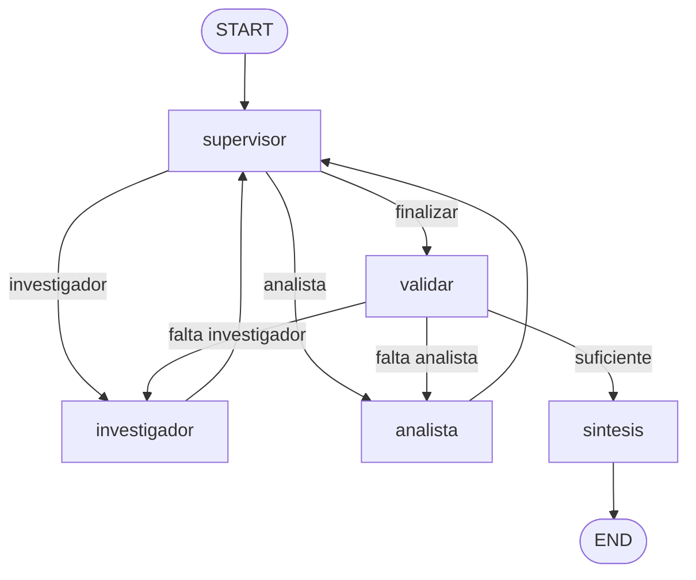

# Pre-entrega 6: orquestador multi-agente

Prototipo de un orquestador de análisis. Una pregunta necesita dos oficios: buscar la política y calcular si el caso entra. Un supervisor decide quién habla. Una validación no deja cerrar si falta uno de los dos.

El caso es de Tienda Lumen, no de las pre-entregas anteriores:

> Un cliente quiere devolver un producto de 14500 pesos a los 12 días. Busca la política de devoluciones y decide si corresponde el reembolso.

La base dice: hasta 10 días y hasta 20000 pesos. El monto entra. El plazo no. La respuesta tiene que salir de esas dos piezas, no de la memoria del modelo.

## Cómo correrlo

Desde la raíz, con el entorno activo:

```bash
source .venv/bin/activate
python unidad_6/pre_entrega/main.py
```

Eso imprime la ruta (`supervisor → investigador → … → sintesis`) y guarda `traza.json`. El notebook `demo.ipynb` corre la misma función.

El enunciado nombra `ChatOpenAI` en otras unidades y, en esta, Tavily o una vector DB. OpenAI se cobra y Tavily pide otra clave. El modelo es Gemini (`GEMINI_API_KEY`, ya en el `.env` de la raíz). Si `gemini-3.1-flash-lite` responde 503 por demanda, la misma llamada pasa a `gemini-flash-lite-latest`. La búsqueda es `buscar_documentos`: una herramienta propia sobre tres políticas. El enunciado lo acepta.

## Topología

Jerárquica. El supervisor es el único router. Investigador y analista no tienen una flecha entre ellos.

Sirve porque el trabajo tiene orden: primero el documento, después la cuenta. En una red, el analista podría inventar el plazo o el investigador podría dar el sí. Acá cada uno tiene una sola herramienta y el otro oficio no está en su prompt.



| Nodo | Qué hace |
|---|---|
| `supervisor` | Elige `investigador`, `analista` o `finalizar` con un `Literal`. |
| `investigador` | ReAct con `buscar_documentos`. Copia la política. No opina. |
| `analista` | ReAct con `validar_reembolso`. Compara días y monto contra plazo y tope. |
| `validar` | Rúbrica. Sin las dos herramientas no hay cierre. |
| `sintesis` | Redacta la respuesta solo con los aportes. |

## Estado compartido

`EstadoOrquestador` hereda de `MessagesState`. Además:

- `aportes`: quién escribió qué, y qué herramienta usó. Se acumula, no se pisa.
- `ruta`: el camino real de la corrida.
- `instruccion`: la frase para el próximo especialista.
- `pasos`: visitas al supervisor.
- `next_agent` y `task_completed`: la decisión de ruteo y si la validación aceptó cerrar.

## Conflictos y el bucle

Los especialistas no editan el mismo texto. Cada uno deja su aporte y vuelve.

- Si el analista corre sin política, su prompt le pide decir «Faltan números» y no inventar el plazo. La validación solo acepta un cálculo que llegó después de la búsqueda. Si el orden salió mal, manda a repetir.
- Si el supervisor dice `finalizar` antes de tiempo, la rúbrica lo corrige y manda al que falta. El print lo marca como `rúbrica`, no como `modelo`.
- Tope: 6 visitas al supervisor y 2 por especialista. Después se sintetiza con lo que haya, aunque falte un dato. El mensaje dice que falta.

El especialista no recibe el historial del grafo. Recibe la pregunta, su tarea y, en el caso del analista, el texto del investigador. Las idas y vueltas de herramientas quedan dentro de su ReAct.

## Archivos

| Archivo | Rol |
|---|---|
| `state.py` | Esquema compartido. |
| `agents/research_agent.py` | Búsqueda. |
| `agents/analyst_agent.py` | Cálculo. |
| `graph.py` | Supervisor, validación, síntesis y flechas. |
| `main.py` | La pregunta de prueba y `traza.json`. |
| `demo.ipynb` | La misma corrida, para entregar como demo. |
