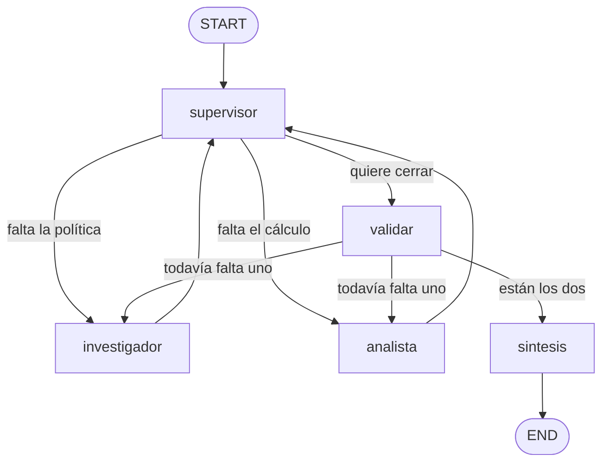

# Pre-entrega 6

Un supervisor reparte. El investigador busca la política. El analista compara los números. Recién ahí se cierra.

La pregunta trae el caso (14500 pesos, 12 días). La base trae la regla (10 días, tope 20000). Ningún agente tiene las dos cosas.

## Qué recordar

- La topología es jerárquica. Los especialistas no se hablan: vuelven al supervisor.
- Cada especialista recibe la pregunta y su tarea, no el historial entero.
- `validar` no deja pasar a la síntesis si falta la búsqueda o el cálculo.
- Cada especialista entra como máximo dos veces. El supervisor, como máximo 6. Ahí se corta.

```bash
python unidad_6/pre_entrega/main.py
```


