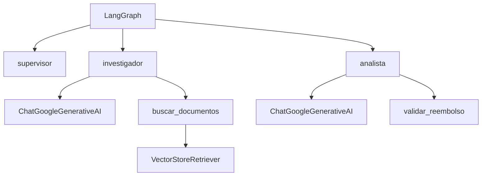

# 7.1 Trazas en Phoenix

El orquestador de la unidad 6 corre contra Phoenix en el puerto 6006. La búsqueda pasa por Chroma, así la traza muestra la base y no solo al modelo.

## Qué recordar

- La espera larga es la llamada al modelo. En el caso de 57,6 s, las 8 llamadas a Gemini suman 56,6 s. La base tardó 0,46 s y el cálculo del reembolso, 2,8 ms.
- Ese caso usó 2014 tokens de entrada y 300 de salida. En el free tier no se cobró. Al precio publicado de `gemini-3.5-flash-lite` serían unos 0,0014 USD.
- Las cinco respuestas usan el plazo de 10 días y el tope de 20000. La quinta agrega una frase que la base no respalda: dice que faltó el dato de «sin uso», y ese dato sí venía en el documento.
- Cortar la base deja `buscar_documentos` y `chroma.buscar_politica` en ERROR. El modelo anterior a la herramienta queda OK.

```bash
# terminal 1
export PHOENIX_WORKING_DIR="$PWD/unidad_7/7.1/phoenix_data"
phoenix serve

# terminal 2, con Phoenix ya en http://localhost:6006
python unidad_7/7.1/instrumentar.py
```


