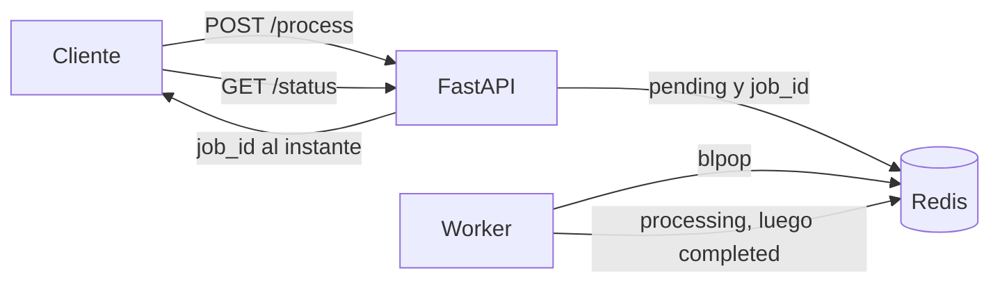

# 7.2 API y cola en Redis

La API no espera al trabajo. Guarda el pedido, devuelve un job_id y cierra. Un worker saca el job de Redis, espera 5 segundos y deja el resultado. El cliente pregunta `/status/{job_id}`.

## Qué recordar

- Primero se escribe `pending`. Después se encola. Si el orden se invierte, el cliente puede recibir un 404.
- `POST /process` responde al instante con `pending`. Enseguida el estado pasa a `processing`. A los 5 segundos, a `completed`.
- Un job_id que no existe responde 404.
- Un reembolso de menos de 1000 sigue solo. Uno de 2500 se pausa con `interrupt` hasta que alguien dice si o no. Al reanudar, el nodo vuelve a empezar, así que el efecto (ejecutar el reembolso) va en el nodo siguiente.

```bash
redis-server --port 6379
python unidad_7/7.2/api.py
```

```bash
curl -X POST localhost:8000/process -H "Content-Type: application/json" -d '{"query": "hola"}'
curl localhost:8000/status/<job_id>
```

```bash
python unidad_7/7.2/aprobacion.py
```


